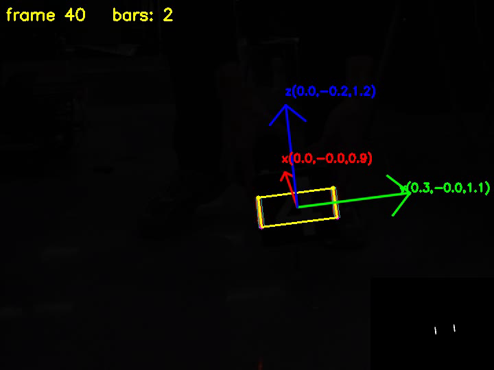
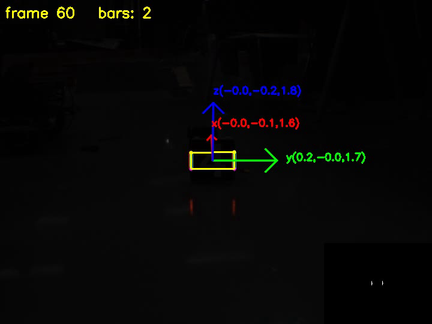

# 装甲板灯条识别 + 位姿解算（RoboMaster 视觉 · 培训阶段 2 任务二）

用 **CMake + OpenCV 4.5.4** 实现装甲板灯条识别与位姿解算：对视频逐帧处理，用颜色和亮度做掩码提取灯条，
拟合可旋转矩形、计算每根灯条的上下端点，把四个端点连成四边形画出装甲板框；
再用 `cv::solvePnP` 解出装甲板相对相机的位姿，并用 `cv::projectPoints` 把 FLU 三维坐标轴画在图上。
全部结果输出为视频。

## 一、我的思路

整个项目是一条流水线，每一步的输出是下一步的输入：

```
视频帧（BGR 彩色图）
   │
   ├─ ① 掩码 + 二值化       颜色条件(R-G) 且 亮度条件(gray) → 只保留灯条像素
   │
   ├─ ② 识别灯条轮廓        findContours 提取连通区域 → minAreaRect 拟合旋转矩形
   │                        → 按 面积/长宽比/长度 筛选 → 面积最大的两个 = 两根灯条
   │
   ├─ ③ 计算上下端点        矩形四个角点按 y 排序 → 上两点中点 / 下两点中点
   │
   ├─ ④ 四端点连成矩形      按 x 分左右 → 左上→右上→右下→左下 连线
   │
   ├─ ⑤ 位姿解算（选做）    solvePnP：4 组「3D 点 ↔ 2D 点」对应 → 旋转 rvec + 平移 tvec
   │                        共面点用 SOLVEPNP_IPPE；并用「装甲板正面朝向相机」先验
   │                        修正平面目标固有的法向符号歧义
   │
   └─ ⑥ 画三维坐标轴（选做）projectPoints 把 FLU 三轴的 3D 端点投回图像 → 画箭头 + 坐标标签
```

### 每一步的判断依据

| 步骤 | 用的特征 | 为什么 |
|---|---|---|
| 掩码·颜色 | `R - G > 20` | 灯条是红的（R 远大于 G）；装甲板白字 R≈G≈B，差值≈0，被滤掉 |
| 掩码·亮度 | `gray > 50` | **灯条自己发光，地面反光只是反射**——这是区分两者的物理本质 |
| 形态学 | `2×2` 开运算 | 远处灯条只有 2~3 像素宽，`3×3` 的核会把它整体腐蚀掉 |
| 轮廓筛选 | 面积>10、长宽比>1.5、长边>12 | 灯条细长；噪点面积小 |
| 选灯条 | 按面积降序取前二 | 画面里最多两根灯条 |
| 端点 | 四角按 y 排序后取中点 | 端点不是角点，是**长轴两端的中心**；角点顺序不保证，必须自己排序 |
| 四边形顺序 | 按 x 分左右后 `左上→右上→右下→左下` | 顺序错了会画成自交的"蝴蝶结" |
| PnP 算法 | `SOLVEPNP_IPPE` | 我们的 4 个端点都在装甲板平面上（**共面**），IPPE 专为此设计，4 点即可解 |
| 3D 点定义 | FLU：x 前 / y 左 / z 上，原点在板中心 | 任务书指定 |
| 朝向修正 | 物体 x 轴在相机系 z 分量为正就翻转 | 共面点无法由几何确定法向符号，需用先验 |

## 二、进度

| 任务书要求 | 状态 |
|---|---|
| 使用 CMake 搭建项目架构 | ✅ |
| 掩码 + 二值化，取灯条像素、过滤干扰 | ✅ |
| 识别灯条轮廓（`cv::findContours`） | ✅ |
| 算每根灯条的上下端点（`cv::minAreaRect`） | ✅ |
| 四个端点按顺序连线画出矩形 | ✅ |
| 对视频逐帧处理（`cv::VideoCapture`） | ✅ |
| 输出能看到每帧处理结果（`cv::imshow` + 结果视频） | ✅ |
| **选做：位姿解算（`cv::solvePnP`）** | ✅ |
| **选做：FLU 三维坐标轴（`cv::projectPoints`）** | ✅ |

**验收数据**：

- 灯条检测：队伍视频共 **101 帧，全部检出且每帧恰好 2 根灯条**；四边形中心与灯条实际位置的偏差 **小于 2 像素**（`tools/audit.cpp` 逐帧验证）
- 位姿解算：**101/101 帧全部解算成功**
- 距离趋势：3.10 m → 1.13 m → 1.74 m，与灯条在画面中的成像长度变化一致；
  另用「灯条长度反推距离」独立交叉验证，误差 5~10%

## 三、效果

**掩码对比**：同样的画面，只用亮度阈值分不开灯条和白色数字；用颜色差值可以滤掉白字。


**灯条检测**（黄框 = 四端点连成的装甲板框，青框 = 每根灯条的最小外接旋转矩形）：


**位姿解算 + FLU 三维坐标轴**（蓝 z 朝上、绿 y 朝侧、红 x 朝前；标签是轴端点在相机坐标系下的米制坐标）：





完整结果视频见 `output/03_最终结果/result.avi`。

## 四、遇到的问题（调试记录）

### 1. OpenCV 的通道顺序是 BGR，不是 RGB

`cv::split` 拆出来是 `ch[0]=B, ch[1]=G, ch[2]=R`。一开始把 `v[0]` 当成红色，
导致颜色判断全部反过来。打印像素值后发现灯条是 `B=40 G=62 R=255`，`v[2]` 才是红。

### 2. 只用亮度分不开灯条和白字

装甲板中间的白色数字亮度和灯条接近，`threshold(gray, 200)` 会把白字一起选进来。
实测：灯条 `R-G=193`，白字 `R-G=0`——必须用颜色，不能只用亮度。

### 3. 阈值调太高，83 帧完全检测不到（最花时间的一个坑）

最初用 `R-G>60 且 gray>100`、`3×3` 形态学核，在测试图上效果完美。
但换到队伍真视频后，**101 帧里 83 帧掩码全黑**，一根灯条都找不到。逐帧打印中间结果才定位到：

| 环节 | 剩多少像素 | 原因 |
|---|---|---|
| `R-G > 60` | 181 | 灯条只有 3~8 像素宽，颜色够但亮度不够 |
| `gray > 100` | 55 | 视频画面极暗（全图平均 R≈5），灯条灰度上不去 |
| `3×3` 开运算 | **0** | 灯条太细，被腐蚀掉了 |

改法：阈值降到 `R-G>20`、`gray>20`，形态学核改成 `2×2`，检出率从 13/101 提到 101/101。

### 4. 地面反光被误选成灯条

放宽阈值后，灯条在地面上的暗红倒影也被选进来了。它和灯条一样是"红色"的，
**颜色条件对它们没有区分力**。真正的区别是亮度（灯条自己发光，反光只是反射）。
把亮度门槛提到 `gray > 50` 后，反光被自然滤掉，**101 帧里每一帧都恰好只剩 2 个候选对象**。

### 5. `imwrite` 失败时不报错

第一次存图时程序打印了 "saved" 但文件根本没生成：`cv::imwrite` 在目标目录不存在时
**静默返回 false**，不抛异常。凡是可能失败的调用（`imread`/`imwrite`/`VideoCapture` 打开/
`VideoWriter` 打开）都必须检查返回值。

### 6. 相对路径是相对"运行目录"的，不是相对项目根目录

程序在 `build/` 里运行，访问项目根的文件要写 `../images/xxx`、`../output/xxx`。

### 7. ★ 平面 PnP 的朝向歧义：x 轴反了（选做部分最大的坑）

位姿解算跑通后，`solvePnP` **返回 true、`tvec` 的数值也合理**（距离 1.74 m 没问题），
但把三维轴画出来后发现有异常：**红色 x 轴指向"远离相机"**，等于把装甲板当成了背面朝向相机。

用 `cv::solvePnPGeneric` 把 IPPE 的两个解都打印出来：

```
sol0  xdir=(+0.15,+0.28,+0.95)   ydir=(-0.98,+0.13,+0.12)   zdir=(-0.09,-0.95,+0.29)
sol1  xdir=(-0.03,-0.24,+0.97)   ydir=(-0.99,+0.13,-0.00)   zdir=(-0.12,-0.96,-0.24)
```

**两个解的 x 轴 z 分量都是正的**（相机系 +z 是"远离相机"），即都认为正面朝外。

**根因**：我们给的 4 个 3D 点 **x 坐标全是 0**（都在装甲板平面上）。
把这 4 个点的 x 全取负，点集完全不变——所以 **PnP 在几何上无法判断平面的法向朝哪边**。
这是平面目标 PnP 的固有二义性，不是 OpenCV 的 bug。

**改法**：用先验知识——比赛里装甲板正面一定朝向相机。
判据：物体 x 轴在相机坐标系的 z 分量 `R(2,0) > 0` 就说明解反了，
此时把 R 右乘 `diag(-1,-1,1)`（等价于绕物体 z 轴转 180°：x、y 反号，z 不变，行列式仍为 +1），
再用 `Rodrigues` 转回旋转向量。

**副作用（是对的，不是 bug）**：翻转后 y 轴从指向图像左侧变成指向右侧。
因为正对着看装甲板时，**它的"左手"在观察者的右手边**——和任务书参考图里绿色 y 轴朝右一致。

**这个教训比代码更值钱**：PnP 不报错、返回 true、`tvec` 也合理，**只有旋转的方向分量错了**。
如果只看返回值和数字，永远发现不了；**必须把结果可视化，用肉眼核对方向是否符合物理常识**。

### 8. 三维坐标标签被箭头盖住 / 跑出画面

- **被盖住**：一开始在一个循环里逐个"画箭头 → 画标签"，后画的箭头会压住先画的标签。
  改成**分两轮画**：先画全部箭头，再画全部标签。
- **跑出画面**：标签固定在轴尖偏移位置，靠边的轴标签会被裁掉。
  用 `cv::getTextSize` 量出文字包围盒，再把坐标钳制在画面内。

## 五、编译运行

```bash
mkdir -p build && cd build
cmake ..
make -j$(nproc)
./lightbar ../video/你的视频.avi
```

- 结果视频：`output/03_最终结果/result.avi`
- 显示窗口放大到 1.8 倍（`WINDOW_NORMAL` + `resizeWindow`，**不影响输出文件的尺寸**）
- 按 `ESC` 可提前退出

调试工具在 `tools/`，默认不编译。需要时：

```bash
cmake -DBUILD_TOOLS=ON .. && make -j$(nproc)
```

## 六、目录结构

```
armor-lightbar/
├── CMakeLists.txt
├── README.md
├── src/
│   └── main.cpp                    ← 作业主程序（灯条识别四步 + 位姿解算两步）
├── video/                          ← 输入视频
├── output/
│   ├── 01_课程记录/                 ← 各阶段成果截图（含最终效果）
│   ├── 02_调试排查/                 ← 调参过程的中间图（不进版本库）
│   └── 03_最终结果/                 ← result.avi 结果视频
└── tools/                          ← 调试/分析工具（非作业内容）
    ├── inspect_video.cpp           ← 打印视频参数
    ├── audit.cpp                   ← 逐帧审计（验证四边形位置）
    ├── probe.cpp / sweep*.cpp      ← 阈值扫描
    ├── detect.cpp / dbg.cpp        ← 单帧候选对象分析
    └── ...
```

## 七、已知局限

| 局限 | 影响 | 说明 |
|---|---|---|
| **装甲板尺寸是假设值**（灯条长 55 mm、两灯条中心距 135 mm） | 解出的**距离绝对数值**可能有偏差 | 任务书未给尺寸。尺寸只影响距离的比例，**对朝向影响很小**，画三维轴足够用 |
| 只支持红灯条 | 蓝灯条视频不适用 | 条件是 `R−G`，换成 `B−G`/`B−R` 即可 |
| 每帧独立解算，未用上一帧做初值 | 极端帧可能抖动 | 可用 `solvePnP` 的 `useExtrinsicGuess=true` + 上一帧结果改进 |
| 没有帧间平滑 | 画面上轴可能轻微抖动 | 可加简单的一阶滤波 |
