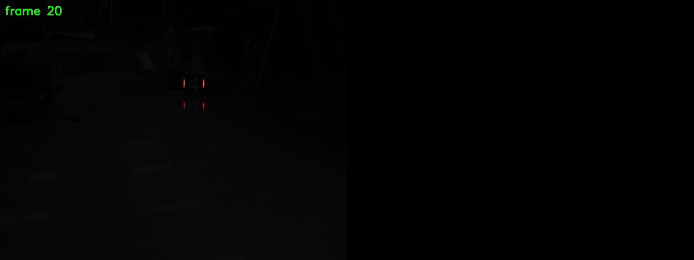
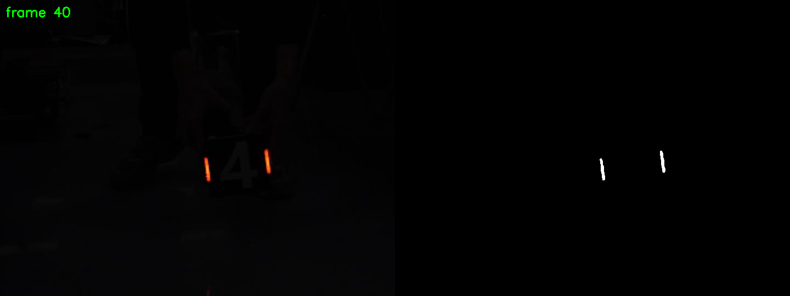

# 装甲板灯条识别（RoboMaster 视觉任务二）

我让大肥鱼教的我全流程，以下是它的述职报告（涉及的内容我都认真学了，不然进度不会这么慢）

用 OpenCV + CMake 实现装甲板灯条识别：对摄像头视频逐帧处理，
通过颜色掩码提取灯条、计算灯条端点的位置。

## 一、我的思路

整个项目是一条流水线，每一步的输出是下一步的输入：

1. **读视频**：`cv::VideoCapture` 逐帧读取，`read()` 返回 false 时结束。
2. **颜色掩码**：灯条是红色（或蓝色），而装甲板上的白色数字是"白得均匀"的。
   用 `R-G` 和 `R-B` 两个通道差值做阈值，可以只留下灯条、滤掉白字。
3. **亮度筛选**：真视频里灯条在地面有暗反光，仅靠颜色会把它也选进来。
   再叠加一个"灰度 > 阈值"的条件，只保留真正发光的灯条。
4. **形态学开运算**：去掉残余的小噪点。
5. **找轮廓**：`cv::findContours` 从掩码中提取连通区域。
6. **拟合矩形**：`cv::minAreaRect` 给每个轮廓拟合可旋转的最小外接矩形，
   得到中心、长宽、倾斜角，用长宽比筛选出真正的灯条。

## 二、目前进度

已完成：**第 1～4 步（掩码）**

| 步骤                         | 状态      |
| ---------------------------- | --------- |
| CMake 项目搭建、能编译运行   | ✅        |
| 单帧掩码对比（亮度 vs 颜色） | ✅        |
| 视频逐帧读取与显示           | ✅        |
| 颜色掩码 + 亮度筛选 + 形态学 | ✅        |
| 轮廓提取与灯条筛选           | ⬜ 进行中 |
| 端点计算与矩形绘制           | ⬜        |
| 输出结果视频                 | ⬜        |

## 三、效果图片

**掩码对比**（左：只看亮度，白字也被选中；右：用颜色差值，只剩灯条）：


**真视频逐帧处理**（左：原视频；右：掩码）：





## 四、遇到的问题

### 1. OpenCV 是 BGR 顺序，不是 RGB

`cv::split` 拆出来的通道是 `ch[0]=B、ch[1]=G、ch[2]=R`。
一开始我以为 `ch[0]` 是红色，取像素时 `v[0]` 也当成了 R，
导致颜色判断全部反过来。后来通过打印像素值才确认：
灯条处 `B=40 G=62 R=255`，`v[2]` 才是红。

### 2. 只用亮度分不开灯条和白字

装甲板中间的白色数字，亮度和灯条差不多。
`threshold(gray, 200)` 会把白字一起选进来。
必须用颜色：灯条的 `R-G` 是 193，白字的 `R-G` 只有 0。

### 3. 真视频里灯条的暗反光会被误选

测试图上掩码很干净，但换成真实视频后，灯条下方的地面反光也被选中了——
它是红色的，通过了颜色条件，但亮度远低于灯条。
解决办法是叠加亮度条件：`灰度 > 100`，再做一次开运算去掉小碎块。

### 4. imwrite 失败时不会报错

第一次保存图片时，程序打印了 "saved" 但文件根本没生成。
原因是 `cv::imwrite` 在目录不存在时**静默返回 false**，不抛异常。
教训：凡是可能失败的调用（`imread`、`imwrite`、`VideoCapture` 打开、
`VideoWriter` 打开）都必须检查返回值。

### 5. 相对路径是相对"运行目录"的

程序在 `build/` 里运行，所以访问项目根目录的文件必须写成 `../images/xxx`。
一开始写成 `images/xxx`，始终读不到。

## 五、编译运行

```bash
mkdir -p build && cd build
cmake ..
make -j$(nproc)
./lightbar ../video/你的视频.avi
```
