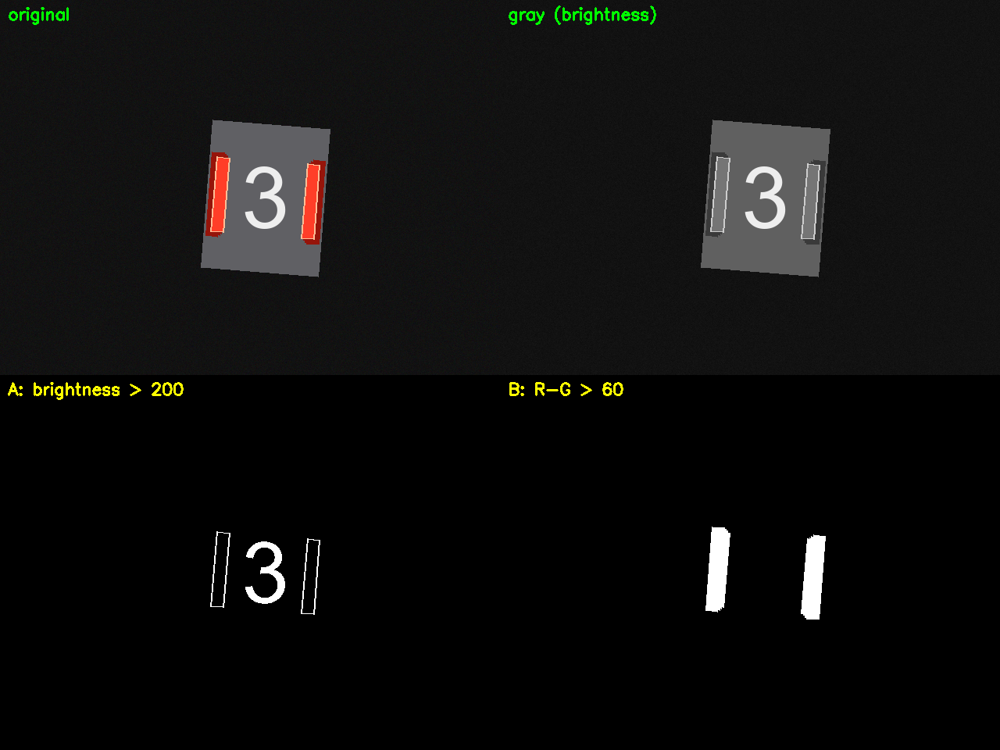
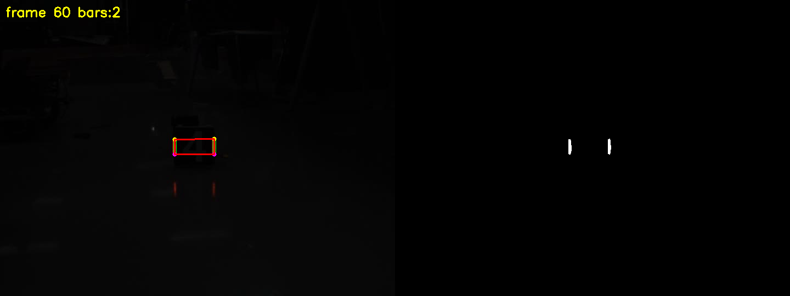
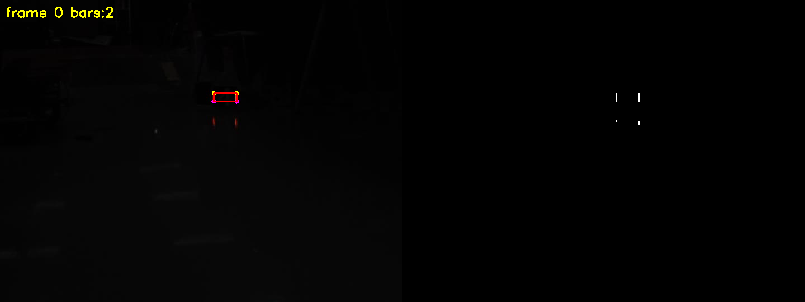

# 装甲板灯条识别（RoboMaster 视觉 · 培训阶段 2 任务二）

用 **CMake + OpenCV 4.5.4** 实现装甲板灯条识别：对视频逐帧处理，用颜色和亮度做掩码提取灯条，
拟合可旋转矩形、计算每根灯条的上下端点，把四个端点连成四边形画出装甲板框，并输出结果视频。

## 一、我的思路

整个项目是一条流水线，每一步的输出是下一步的输入：

```
视频帧（BGR 彩色图）
   │
   ├─ ① 掩码 + 二值化       颜色条件(R-G) 且 亮度条件(gray) → 只保留灯条像素
   │
   ├─ ② 识别灯条轮廓        findContours 提取连通区域 → minAreaRect 拟合旋转矩形
   │                        → 按 面积/长宽比/长度 筛选 → 面积最大的两个 = 两根灯条
   │
   ├─ ③ 计算上下端点        矩形四个角点按 y 排序 → 上两点中点 / 下两点中点
   │
   └─ ④ 四端点连成矩形      按 x 分左右 → 左上→右上→右下→左下 连线
```

### 每一步的判断依据

| 步骤 | 用的特征 | 为什么 |
|---|---|---|
| 掩码·颜色 | `R - G > 20` | 灯条是红的（R 远大于 G）；装甲板白字 R≈G≈B，差值≈0，被滤掉 |
| 掩码·亮度 | `gray > 50` | **灯条自己发光，地面反光只是反射**——这是区分两者的物理本质 |
| 形态学 | `2×2` 开运算 | 远处灯条只有 2~3 像素宽，`3×3` 的核会把它整体腐蚀掉 |
| 轮廓筛选 | 面积>10、长宽比>1.5、长边>12 | 灯条细长；噪点面积小 |
| 选灯条 | 按面积降序取前二 | 画面里最多两根灯条 |
| 端点 | 四角按 y 排序后取中点 | 端点不是角点，是**长轴两端的中心**；角点顺序不保证，必须自己排序 |
| 四边形顺序 | 按 x 分左右后 `左上→右上→右下→左下` | 顺序错了会画成自交的"蝴蝶结" |

## 二、目前进度：全部必做项已完成

| 任务书要求 | 状态 |
|---|---|
| 使用 CMake 搭建项目架构 | ✅ |
| 掩码 + 二值化，取灯条像素、过滤干扰 | ✅ |
| 识别灯条轮廓（`cv::findContours`） | ✅ |
| 算每根灯条的上下端点（`cv::minAreaRect`） | ✅ |
| 四个端点按顺序连线画出矩形 | ✅ |
| 对视频逐帧处理（`cv::VideoCapture`） | ✅ |
| 输出能看到每帧处理结果（`cv::imshow` + 结果视频） | ✅ |

**验收数据**：队伍视频共 **101 帧，全部检出且每帧恰好 2 根灯条**；四边形中心与灯条实际位置
的偏差 **小于 2 像素**（逐帧审计脚本 `tools/audit.cpp` 验证）。选做的 PnP 位姿解算按任务书要求未做。

## 三、效果

**掩码对比**：同样的画面，只用亮度阈值分不开灯条和白色数字；用颜色差值可以滤掉白字。



**最终效果**：红框 = 四端点连成的装甲板框，绿框 = 每根灯条的最小外接旋转矩形，
黄/紫点 = 上下端点，右下角小图 = 掩码。





结果视频见 `output/03_最终结果/result.avi`。

## 四、遇到的问题（调试记录）

### 1. OpenCV 的通道顺序是 BGR，不是 RGB

`cv::split` 拆出来是 `ch[0]=B, ch[1]=G, ch[2]=R`。一开始把 `v[0]` 当成红色，
导致颜色判断全部反过来。打印像素值后发现灯条是 `B=40 G=62 R=255`，`v[2]` 才是红。

### 2. 只用亮度分不开灯条和白字

装甲板中间的白色数字亮度和灯条接近，`threshold(gray, 200)` 会把白字一起选进来。
实测：灯条 `R-G=193`，白字 `R-G=0`——必须用颜色，不能只用亮度。

### 3. 阈值调太高，83 帧完全检测不到（最花时间的一个坑）

最初用 `R-G>60 且 gray>100`、`3×3` 形态学核，在测试图上效果完美。
但换到队伍真视频后，**101 帧里 83 帧掩码全黑**，一根灯条都找不到。逐帧打印中间结果才定位到：

| 环节 | 剩多少像素 | 原因 |
|---|---|---|
| `R-G > 60` | 181 | 灯条只有 3~8 像素宽，颜色够但亮度不够 |
| `gray > 100` | 55 | 视频画面极暗（全图平均 R≈5），灯条灰度上不去 |
| `3×3` 开运算 | **0** | 灯条太细，被腐蚀掉了 |

改法：阈值降到 `R-G>20`、`gray>20`，形态学核改成 `2×2`，检出率从 13/101 提到 101/101。

### 4. 地面反光被误选成灯条

放宽阈值后，灯条在地面上的暗红倒影也被选进来了。它和灯条一样是"红色"的，
**颜色条件对它们没有区分力**。真正的区别是亮度：

| | 灯条 | 地面反光 |
|---|---|---|
| 本质 | 自己发光 | 反射灯光，能量衰减 |
| 图形上的长度 | 长 | 短 |
| 亮度 | 高 | 低 |

所以把亮度门槛提到 `gray > 50`，反光被自然滤掉，掩码里只剩两根灯条——
**这个改动之后，101 帧里每一帧都恰好只剩 2 个候选对象，反光零残留。**

### 5. `imwrite` 失败时不报错

第一次存图时程序打印了 "saved" 但文件根本没生成：`cv::imwrite` 在目标目录不存在时
**静默返回 false**，不抛异常。凡是可能失败的调用（`imread`/`imwrite`/`VideoCapture` 打开/
`VideoWriter` 打开）都必须检查返回值。

### 6. 相对路径是相对"运行目录"的，不是相对项目根目录

程序在 `build/` 里运行，访问项目根的文件要写 `../images/xxx`、`../output/xxx`。

## 五、编译运行

```bash
mkdir -p build && cd build
cmake ..
make -j$(nproc)
./lightbar ../video/你的视频.avi
```

- 结果视频：`output/03_最终结果/result.avi`
- 按 `ESC` 可提前退出

调试工具在 `tools/`，默认不编译。需要时：

```bash
cmake -DBUILD_TOOLS=ON .. && make -j$(nproc)
```

## 六、目录结构

```
armor-lightbar/
├── CMakeLists.txt
├── README.md
├── src/
│   └── main.cpp                    ← 作业主程序（全部四步）
├── video/                          ← 输入视频
├── output/
│   ├── 01_课程记录/                 ← 各阶段成果截图
│   ├── 02_调试排查/                 ← 调参过程的中间图
│   └── 03_最终结果/                 ← result.avi 结果视频
└── tools/                          ← 调试/分析工具（非作业内容）
    ├── inspect_video.cpp           ← 打印视频参数
    ├── audit.cpp                   ← 逐帧审计（验证四边形位置）
    ├── probe.cpp / sweep*.cpp      ← 阈值扫描
    ├── detect.cpp / dbg.cpp        ← 单帧候选对象分析
    └── ...
```
